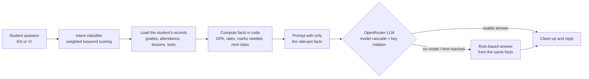
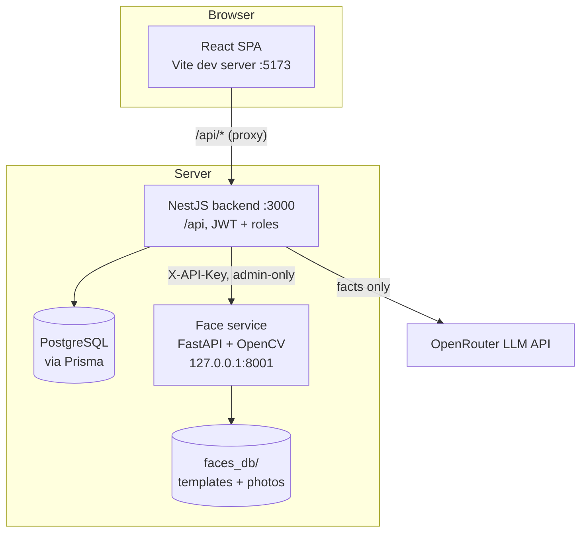

# AcadAI: AI Academic Advisor

**AcadAI** is a web-based academic advisor for university students and staff. Students ask questions in plain English or Vietnamese, such as *"Am I at risk in any course?"*, *"What score do I need on the DSA202 final?"* or *"Where is my next class?"*, and get answers built from their **own** grades, attendance and timetable. The system also warns about at-risk students early, takes classroom attendance with face recognition, generates practice quizzes from lesson material, and includes an interactive campus map.


> **Design principle: the AI never invents facts.** Every number (GPA, attendance rate, final mark needed, next class, exam room) is calculated in code from the database first. The language model only phrases those facts. If no model is available, a rule-based engine gives the same answers on its own.

---

## Contents

- [Features](#features)
- [How the AI advisor works](#how-the-ai-advisor-works)
- [Architecture](#architecture)
- [Tech stack](#tech-stack)
- [Project structure](#project-structure)
- [Getting started](#getting-started)
- [Configuration](#configuration)
- [Testing and evaluation](#testing-and-evaluation)
- [Security and privacy](#security-and-privacy)
- [Known limitations](#known-limitations)
- [Documentation](#documentation)

---

## Features

### For students
- **AI chat advisor** (full page and a floating chat bubble on every page): answers about GPA, final-exam marks needed, attendance and exam eligibility, exam dates and rooms, class schedule, room locations and career roadmaps. Mentioned rooms become "show on map" buttons.
- **Dashboard:** GPA and target, attendance, this week's real timetable with attended/absent/late status, per-course standings and early-warning notices.
- **Early-warning risk score** per course (LOW / MODERATE / HIGH) from attendance, midterm and practice-quiz results, always with plain-language reasons.
- **Grades, attendance and classes** pages, including self-enrolment.
- **Practice quizzes:** the AI writes 8 multiple-choice and 2 short-answer questions from the class's lesson material, falling back to a fixed question bank. Answers are revealed only after submitting, and short answers are graded by the AI with feedback.
- **Interactive campus map** of Level 2 (about 27 rooms and facilities), with room search and highlighting.
- **Profile and goals:** target career and target GPA, which personalise the advisor.

### For administrators
- Create classes, lessons (with PDF / DOCX / TXT material upload) and tests; manage enrolments; enter grades.
- List of **at-risk students** across the institution.
- **Face registration** (webcam) and **face attendance** from a webcam or class photo. The admin reviews the recognised students before attendance is saved.

Full, checked feature list: [FEATURES.md](FEATURES.md).

---

## How the AI advisor works



1. **Intent classification** routes the question to one of six intents: schedule/location, attendance, exam, GPA, career or general. It uses weighted English and Vietnamese keyword rules ([`intent-classifier.ts`](backend/src/ai/intent-classifier.ts)).
2. **Facts are computed in code** using one shared set of grading rules ([`common/grading.ts`](backend/src/common/grading.ts)). For general questions, matching passages from uploaded lesson material are added ([`lesson-retrieval.ts`](backend/src/ai/lesson-retrieval.ts)).
3. **The LLM only phrases the facts.** The model receives a short prompt with the relevant data and a format template, never example numbers it could copy.
4. **Reliability:** free OpenRouter models are tried in turn within a 25-second budget. Up to 9 API keys rotate automatically when one reaches its free daily limit ([`common/openrouter.ts`](backend/src/common/openrouter.ts)). If everything fails, a deterministic rule-based answer is returned, so the chat always works.

---

## Architecture



- The **browser never talks to the face service directly**. Face requests go through admin-only backend endpoints (`/api/face/*`), and the backend authenticates to the face service with a shared key. The face service listens on localhost only.
- All grading and attendance rules live in one module per side: [`backend/src/common/grading.ts`](backend/src/common/grading.ts) and its frontend mirror [`frontend/src/utils/grading.ts`](frontend/src/utils/grading.ts).

---

## Tech stack

| Layer | Technology |
|---|---|
| Frontend | React 18, TypeScript, Vite 6, Tailwind CSS 3, React Router 6, Axios |
| Backend | NestJS 10, TypeScript, Prisma 5, PostgreSQL, JWT (Passport), bcrypt, class-validator, pdf-parse, mammoth |
| AI | OpenRouter (free models), rule-based fallback |
| Face recognition | Python, FastAPI, OpenCV (Haar cascade detection + CLAHE + 400-d region histograms), NumPy, Pillow |
| Testing | Node.js built-in test runner (unit), integration script, live AI evaluation, face benchmark |

---

## Project structure

```
acadai/
├── backend/                 NestJS API
│   ├── prisma/              schema, migrations, seed scripts
│   ├── src/
│   │   ├── ai/              chat advisor, intent classifier, lesson retrieval
│   │   ├── auth/            JWT login, roles, secret guard
│   │   ├── common/          shared grading rules, OpenRouter client
│   │   ├── face/            admin-only proxy to the face service
│   │   ├── users/           profile, dashboard, early-warning risk engine
│   │   └── …                classes, lessons, attendance, grades, tests, conversations
│   └── test/                unit/, live/ (AI evaluation), test-runner.ts (integration)
├── frontend/                React SPA (pages, components, utils/grading.ts)
├── face-service/            FastAPI + OpenCV face recognition (see its README)
├── FEATURES.md              what the system actually does
├── ISSUES.md                problems found, fixes, open backlog
└── AI_EVALUATION.md         live AI test method and results
```

---

## Getting started

### Prerequisites
- Node.js 20.12 or newer (the backend uses Node's built-in `.env` loader)
- PostgreSQL 14+ with an empty database (e.g. `acadai`)
- Python 3.10+ (only for face attendance)
- Optional: one or more [OpenRouter](https://openrouter.ai) API keys. Without them, the chat uses its rule-based answers, quizzes come from the question bank, and short answers are not auto-graded.

### 1. Backend
```bash
cd backend
cp .env.example .env        # fill in the values, see Configuration below
npm install
npx prisma migrate deploy   # create the tables
npm run db:seed             # demo accounts and data
npm run start:dev           # http://localhost:3000/api
```
Optional extra data: `npx ts-node prisma/seed-large.ts` (about 60 students) and `npx ts-node prisma/seed-roadmaps.ts` (career roadmaps used by the advisor).

### 2. Frontend
```bash
cd frontend
npm install
npm run dev                 # http://localhost:5173 (proxies /api to :3000)
```

### 3. Face service (optional, for face attendance)
```bash
cd face-service
python -m venv venv
venv\Scripts\activate       # macOS/Linux: source venv/bin/activate
pip install -r requirements.txt
copy .env.example .env      # macOS/Linux: cp; set FACE_SERVICE_API_KEY (same value as backend/.env)
python main.py              # http://127.0.0.1:8001
```
On Windows, `start.bat` does the same. Generate a key with:
```bash
python -c "import secrets; print(secrets.token_urlsafe(32))"
```

### Demo accounts
`npm run db:seed` creates one admin and demo students; the accounts are listed in [`backend/prisma/seed.ts`](backend/prisma/seed.ts). In development mode (`npm run dev`), the login page has quick-fill buttons for them. Production builds do not include these buttons or the passwords. **Change the seeded admin password on any shared or deployed database.**

Public sign-up always creates a **student** account; admin accounts come only from the seed.

### Production build
```bash
cd backend && npm run build && npm start   # runs dist/src/main.js
cd frontend && npm run build               # static files in frontend/dist
```

---

## Configuration

`backend/.env` (template: [`backend/.env.example`](backend/.env.example)):

| Variable | Required | Description |
|---|---|---|
| `DATABASE_URL` | yes | PostgreSQL connection string |
| `JWT_SECRET` | yes | At least 16 characters; the server refuses to start without it |
| `JWT_EXPIRES_IN` | no | Token lifetime, default `7d` |
| `PORT` | no | Default `3000` |
| `OPENROUTER_API_KEY` | no | Main AI key |
| `OPENROUTER_API_KEY_2` … `_9` | no | Backup keys, used in order when a key reaches its free daily limit |
| `OPENROUTER_MODEL` | no | Default `openrouter/free` |
| `FACE_SERVICE_URL` | no | Default `http://127.0.0.1:8001` |
| `FACE_SERVICE_API_KEY` | for face features | Must equal the value in `face-service/.env` |

`face-service/.env` (template: [`face-service/.env.example`](face-service/.env.example)): `FACE_SERVICE_API_KEY` (required), `FACE_SERVICE_HOST` (default `127.0.0.1`), `FACE_ALLOWED_ORIGINS` (normally empty).

> **Free AI tier:** OpenRouter free models allow 50 requests per day per account (1,000 after buying 10 credits) and 20 per minute. One chat message can use several requests. For a live demo, add credits or configure backup keys.

---

## Testing and evaluation

| Command | What it checks |
|---|---|
| `cd backend && npm run test:unit` | **52 unit tests**, no database needed: grading and GPA rules, intent classifier (33 labelled EN/VI questions), OpenRouter key rotation, quiz validation and scoring, lesson retrieval, rule-based chat answers, JWT secret guard |
| `cd backend && npm test` | **Integration tests (5)** against the database: connectivity, roles and password hashing, idempotent batch attendance, the real risk engine on real data, face-service health. Restores every record it touches |
| `cd backend && npm run test:ai-live` | **Live AI evaluation** with the real OpenRouter API (uses quota): 12 questions with fact checks, plus quiz generation and grading |
| `cd face-service && venv\Scripts\python.exe benchmark.py` | Face-service sanity checks and latency |

**Results** (details in [AI_EVALUATION.md](AI_EVALUATION.md)):
- **Live AI advisor (after prompt fixes):** 24 of 24 answers came from the LLM, were routed to the right intent and had correct facts, with no invented course codes. Median response time is about 3 seconds.
- **Intent classifier:** the original classifier answered 22 of 30 test questions correctly. The new one passes all of them and the extended 33-question set. This set was written during development, so it is a regression test, not an independent benchmark.
- **Integration tests:** 5/5, with a database fingerprint identical before and after.
- **Face benchmark:** 6/6 sanity checks, about 40 ms per frame. These are not an accuracy measurement (see limitations).

---

## Security and privacy

- **Authentication:** JWT login with bcrypt-hashed passwords. Role-based access (student / admin) is enforced on every admin endpoint. Public sign-up cannot create admins.
- **Secrets:** all secrets come from `.env` files (never committed). The server will not start with a missing or weak JWT secret.
- **Face service:** admin-only through the backend, with a shared API key, localhost only, and no browser CORS.
- **Biometric data:** face photos and templates are sensitive personal data under Vietnam's Decree 13/2023/ND-CP. They stay on the institution's server and are never sent to cloud services. Consent, access and deletion rules are in [face-service/README.md](face-service/README.md#biometric-data-and-privacy).
- **AI and student data:** when an OpenRouter key is configured, the relevant academic facts (e.g. grades, attendance) are sent to the AI provider to phrase the answer. Use a self-hosted model if this is not acceptable for your institution.
- **Practice quizzes:** correct answers are sent to the browser only after the quiz is submitted.

---

## Known limitations

- **Face recognition** uses classical features and has **not been evaluated on real classroom photos**. It has no liveness / anti-spoofing check, so a printed photo could be accepted. An admin must supervise and review face attendance.
- **Free AI models** vary in quality and have daily limits; when they are unavailable, answers fall back to the rule-based engine.
- **Small AI evaluation:** 12 questions, 3 runs, one demo student.
- **Career roadmaps** exist for 4 careers only.
- The semester label ("Semester 5") is fixed in the UI.
- The app has not been deployed to a public server.

The full list, with what was fixed and what is still open, is in [ISSUES.md](ISSUES.md).

---

## Documentation

| Document | Contents |
|---|---|
| [FEATURES.md](FEATURES.md) | Every feature, its status (works / partial) and where it lives in the code |
| [ISSUES.md](ISSUES.md) | Problems found during review and testing, fixes made, open backlog |
| [AI_EVALUATION.md](AI_EVALUATION.md) | Live AI evaluation method, results and limitations |
| [face-service/README.md](face-service/README.md) | Face recognition method, API, privacy rules, limitations |
